# Financial Study

LangGraph workflows for PDF-based financial study, RAG chat, and quizzes.

## What It Does

The ingestion command extracts and chunks financial-study PDFs, embeds them, and stores them in Qdrant. The study graph summarizes a chapter and advances Redis progress; the chat graph answers questions from chunks already marked as studied. A FastAPI app serves chat, quiz, and teaching endpoints to the included React UI. LangGraph CLI can serve the two compiled graphs independently of that FastAPI app.

```mermaid
%% Dashed arrows are conditional routes; labels are routing outcomes.
flowchart TD
	subgraph study["Study graph"]
		study_start([<p>__start__</p>]):::first
		filter_by_memory(filter_by_memory)
		summarise_chunks(summarise_chunks)
		validate_summary(validate_summary)
		update_progress(update_progress)
		study_end([<p>__end__</p>]):::last
		study_start --> filter_by_memory;
		filter_by_memory --> summarise_chunks;
		summarise_chunks --> validate_summary;
		validate_summary -. &nbsp;retry&nbsp; .-> summarise_chunks;
		validate_summary -. &nbsp;max_retries&nbsp; .-> update_progress;
		update_progress --> study_end;
	end
	subgraph chat["Chat graph"]
		chat_start([<p>__start__</p>]):::first
		guardrail_node(guardrail_node)
		rag_lookup_node(rag_lookup_node)
		validate_response_node(validate_response_node)
		chat_end([<p>__end__</p>]):::last
		chat_start --> guardrail_node;
		guardrail_node -. &nbsp;flagged&nbsp; .-> chat_end;
		guardrail_node -. &nbsp;clean&nbsp; .-> rag_lookup_node;
		rag_lookup_node -. &nbsp;evidence_missing&nbsp; .-> chat_end;
		rag_lookup_node -. &nbsp;has_evidence&nbsp; .-> validate_response_node;
		validate_response_node -. &nbsp;max_retries&nbsp; .-> chat_end;
		validate_response_node -. &nbsp;retry&nbsp; .-> rag_lookup_node;
	end
classDef default fill:#f2f0ff,line-height:1.2
classDef first fill-opacity:0
classDef last fill:#bfb6fc
```



## Features

- PDF metadata extraction, chapter filtering, overlapping chunking, embeddings, and Qdrant indexing.
- Study summaries with LLM quality/length validation and retry routing.
- Guardrails and evidence-gated RAG over seen study chunks.
- Quiz generation from completed chapters, Redis quiz caching, and answer grading.
- FastAPI chat, quiz, and teach endpoints; React/Vite web client and interactive CLI.

## Prerequisites

- Python 3.12 and [uv](https://docs.astral.sh/uv/getting-started/installation/).
- Qdrant and Redis for the current graph workflows.
- A Google API key for the example Gemini models, or credentials for your chosen
  internet model provider. Ollama is optional for local model use.
- Node.js/npm only when rebuilding the React UI.
- Docker Desktop with Linux containers for the Compose stack, or `langgraph build`.
- PostgreSQL only if applying the current Alembic schema; application progress is still Redis-backed.

## Installation

Run from the repository root in PowerShell:

```powershell
uv sync --extra dev
Copy-Item .env.example .env
```

Edit `.env` to provide `GOOGLE_API_KEY` and any service URLs that differ from your
local defaults. Start Qdrant and Redis before invoking workflows that use them;
start Ollama only if choosing a local Ollama model.

To build the web UI before serving it:

```powershell
Push-Location frontend/ui
npm install
npm run build
Pop-Location
```

## Configuration

The example environment uses `google_genai:gemini-2.5-flash` for chat and study.
The Python settings retain Ollama defaults when no model environment variables
are set. Google credentials are required only for Gemini; LangSmith is optional.

| Variable | Required | Purpose | Example placeholder |
|---|---|---|---|
| `LLM_CHAT_MODEL_NAME` | No | Chat and quiz model | `ollama:<model>` |
| `LLM_STUDY_MODEL_NAME` | No | Study summary model | `google_genai:<model>` |
| `LLM_TEMPERATURE` | No | Summary generation temperature | `<float>` |
| `LLM_KEY_ENCRYPTION_KEY` | For browser selections | Fernet key for encrypted Redis credentials | `<Fernet key>` |
| `LLM_SESSION_TTL_SECONDS` | No | Browser selection/cookie lifetime, 60-604800 seconds (default 43200) | `<seconds>` |
| `GOOGLE_API_KEY` | For Gemini | Google model credential | `<Google API key>` |
| `EMBEDDING_MODEL_NAME` | No | Embedding model | `<HuggingFace model>` |
| `EMBEDDING_NORMALIZE` | No | Normalize embeddings | `<true or false>` |
| `QDRANT_URL` | For graph/ingestion | Vector database URL | `<Qdrant URL>` |
| `QDRANT_COLLECTION` | No | Vector collection | `<collection name>` |
| `RAG_TOP_K` | No | Retrieved chunks per search | `<integer>` |
| `CHUNK_SIZE` | No | Ingestion chunk size | `<integer>` |
| `CHUNK_OVERLAP` | No | Ingestion overlap | `<integer>` |
| `REDIS_URL` | For Redis-backed features | Progress, memory, and quiz cache | `redis://<host>:6379` |
| `DATABASE_URL` | Alembic only | PostgreSQL connection string | `postgresql+asyncpg://<user>:<password>@<host>:5432/<database>` |
| `LANGSMITH_TRACING` | No | Tracing toggle | `<true or false>` |
| `LANGSMITH_API_KEY` | LangSmith only | Tracing credential | `<LangSmith API key>` |
| `LANGSMITH_PROJECT` | No | Trace project name | `<project name>` |
| `OLLAMA_BASE_URL`, `OLLAMA_MODEL` | No | Base URL default for a browser Ollama selection; legacy model selection still uses `LLM_*_MODEL_NAME` | `<Ollama URL>`, `<model>` |
| `QUIZ_DEFAULT_COUNT`, `QUIZ_CACHE_TTL` | No | Declared settings; quiz code currently uses its own defaults/constants | `<integer>`, `<seconds>` |

`DATABASE_URL` is used by Alembic configuration; PostgreSQL is not currently used by the API or graphs. See [`.env.example`](.env.example) for a secret-free template.

### Browser model settings

Open **LLM settings** in the web UI to choose Azure OpenAI, Anthropic Claude,
Ollama, Google Gemini, or an installed LangChain `provider:model` integration.
Model suggestions are editable examples, not an account-specific availability list.
One saved selection overrides the model for chat, quizzes, and study; clearing it
or expiry restores the separate environment defaults. CLI/direct graph calls
without a browser session continue to use those defaults.

Generate a Fernet encryption key locally:

```powershell
uv run python -c "from cryptography.fernet import Fernet; print(Fernet.generate_key().decode())"
```

Set `LLM_KEY_ENCRYPTION_KEY` in your untracked `.env`, consistently across workers.
Redis must be available to save/read selections. Credentials and provider fields
are encrypted together under `llm:sess:<random UUID>` with a 12-hour TTL by default.
They are never stored in localStorage or graph state. The browser only holds an
HttpOnly, SameSite=Lax cookie (Secure over HTTPS). GET returns a masked suffix,
never a reusable key. A blank key retains a saved key only for the same provider
and endpoint (and same integration for Custom); supply a new key when changing
those. Clear deletes the Redis entry and cookie. Lost/rotated encryption keys
make existing selections unreadable: clear them and re-enter credentials.

**Test connection** sends only a short test prompt, may incur provider charges,
and does not save the form. It can test a submitted form or the saved selection.
Azure requires an HTTPS endpoint, API version and deployment; Ollama's URL is
resolved from the server, not the browser. Custom supports installed integrations
and an optional generic API key, not arbitrary provider-specific configuration.
Missing packages or unsupported model parameters produce a failed connection test.
Model calls use a 30-second client timeout for browser selections.

`GET /api/llm/providers`, `GET/PUT/DELETE /api/llm/config`, and
`POST /api/llm/test` are served by FastAPI, not the separate LangGraph server.
Settings errors omit submitted inputs and raw provider exceptions. Browser
session workflows and connection tests disable LangSmith tracing, including
quiz worker calls; environment-only workflows keep their existing tracing policy.

**Deployment limit:** this is still a trusted local application, not an
authenticated multi-user product. The anonymous settings cookie isolates model
credentials only; chat history, chapter progress, and studied material remain
global. Restrict access to the server, use HTTPS and trusted network egress
controls before remote deployment, and protect the Redis database and encryption
key. Custom/Ollama endpoints are user-selected server-side destinations, not
safe to expose to untrusted users. No account authorization or endpoint allowlist
is provided by this feature.

## Running

Start the LangGraph development server from the repository root:

```powershell
uv run langgraph dev
```

This serves the compiled graphs through the LangGraph API server. It does not serve the existing FastAPI routes.

Run the PDF ingestion pipeline, study flow, one-off chat, interactive CLI, or FastAPI server with:

```powershell
uv run python main.py ingest --source-dir data
uv run python main.py run
uv run python main.py chat "What is a bond?"
uv run python -m frontend.cli
uv run python -m frontend.server
```

The LangGraph chat graph can also be invoked directly:

```python
from graph.graph_builder import chat_graph

result = chat_graph.invoke({"user_input": "What is a stock?"})
print(result["chatbot_response"])
```

The result is the graph state, including `chatbot_response`; its content depends on model output and available Qdrant evidence.

## Project Structure

```text
config/                  Pydantic application settings
data/                    Source financial-study PDFs
docs/                    Architecture guide and generated graph diagram
frontend/server.py       FastAPI API and static UI host
frontend/cli.py          Interactive chatbot CLI
frontend/ui/              React/Vite UI source
frontend/static/          Built UI assets
graph/                    Graph state, builders, and node functions
ingestion/                PDF extraction, chunking, embeddings, and Qdrant
infrastructure/database/ SQLAlchemy models and async session factory
memory/                   Redis chat memory and progress
quiz/                     Quiz generation and grading
llm/                      Provider selection, model factory, encrypted session credentials
alembic/                  PostgreSQL migrations
scripts/                  Graph diagram generator
tests/                    API, ingestion, quiz, and database tests
main.py                   Ingestion, study, and chat CLI
langgraph.json            LangGraph CLI manifest
```

## Testing and Linting

```powershell
uv run pytest
uv run ruff check .
uv run ruff format --check .
uv run pyright
```

Regenerate the diagram after graph edits with `uv run python -m scripts.generate_graph`.

## Deployment

### Run the web stack with Docker Compose

Quick start, from the repository root in PowerShell:

```powershell
Copy-Item .env.example .env   # then set GOOGLE_API_KEY and LLM_KEY_ENCRYPTION_KEY
docker compose up --build -d --wait --wait-timeout 180
docker compose exec app python main.py ingest --source-dir data
```

Then open http://localhost:8010. The steps below explain each part.

Compose starts the FastAPI app with a freshly built React UI, Redis, and Qdrant.
Models use internet providers; no Ollama container is included. PostgreSQL is
omitted because application workflows do not use it. The separate LangGraph
development server is not needed for this UI.

1. Start Docker Desktop with Linux containers.
2. Copy `.env.example` to `.env` if you do not already have one. Set
   `GOOGLE_API_KEY` for the default Gemini models, or set the appropriate provider
   credentials and `LLM_CHAT_MODEL_NAME` / `LLM_STUDY_MODEL_NAME`.
3. Generate the encryption key and paste it into `LLM_KEY_ENCRYPTION_KEY` in `.env`:

   ```powershell
   docker run --rm python:3.12-slim python -c "import base64, secrets; print(base64.urlsafe_b64encode(secrets.token_bytes(32)).decode())"
   ```

4. Build and start everything:

   ```powershell
   docker compose up --build -d --wait --wait-timeout 180
   ```

Open http://localhost:8010. Provider choices can also be saved through **LLM
settings**; a saved selection overrides the environment models. The encryption
key is required even if you only choose a provider later. Keep it stable across
container replacements to retain access to saved credentials.

#### Ingest the PDFs

Ingestion is a separate step; the app does not run it on startup. Run it once
after the stack is healthy:

```powershell
docker compose exec app python main.py ingest --source-dir data
```

The `data` folder is bind-mounted into the container, so the 18 PDFs in
[data/](data/) are available there without rebuilding the image. Ingestion
embeds every chunk and writes it to Qdrant. Markdown copies of the chunks are
written to `data/md/`.

Ingestion does not deduplicate. Running it again adds duplicate vectors to
Qdrant. To re-ingest from scratch, delete the collection first:

```powershell
docker compose exec app python -c "from qdrant_client import QdrantClient; from config.settings import settings; QdrantClient(url=settings.qdrant_url).delete_collection(settings.qdrant_collection)"
docker compose exec app python main.py ingest --source-dir data
```

After ingesting, use **Next Chapter** or **Restart Teaching** in the UI to mark
chapters as studied. RAG chat and quizzes only use studied chapters.

Embeddings run locally inside the app with HuggingFace, not through an internet
LLM. The first ingestion downloads the embedding model into the
`huggingface_cache` volume. The first image build downloads large Python/ML
dependencies and needs internet access and several GB of disk space. CPU
execution is used.

Compose overrides Redis/Qdrant URLs with container hostnames. Existing `.env`
model choices still win over Compose defaults: replace any `ollama:...` values
when using internet providers. Only the web port is published, bound to loopback;
Redis and Qdrant are not exposed to the host. The app health check probes the
web route, Redis and Qdrant, not provider credentials or the presence of ingested
material. Provider access must be verified with **Test connection**.

```powershell
docker compose logs -f app
docker compose down
```

Redis, Qdrant, and embedding-cache data persist in named volumes; source PDFs and
generated Markdown use the bind-mounted `data` directory. Do not run
`docker compose down -v` unless you intend to delete the stored state and cache.
The host encryption key must be backed up separately from Redis data.

### Separate LangGraph server

The manifest declares the `study` and `chat` graphs in `graph/graph_builder.py`. Build the LangGraph API server Docker image with:

```powershell
uv run langgraph build -t financial-study:latest
```

Docker must be installed and running. This image serves the graphs, not
`frontend.server`; use the Compose stack above for the FastAPI/UI routes.

`langgraph.json` keys:

| Key | Meaning |
|---|---|
| `dependencies` | Use the repository root project dependencies |
| `graphs` | Map graph IDs to compiled Python graph exports |
| `env` | Load local environment settings from `.env` |
| `python_version` | Build with Python 3.12 |

Validate locally with `uv run langgraph dev`; validate/build the Docker image with `uv run langgraph build -t financial-study:latest`.

## Documentation

See [docs/architecture.md](docs/architecture.md) for state fields, node behavior, routes, persistence, and deployment details.

## Contributing and License

TODO: confirm contribution instructions and license. No contributing guide or license file is present in the repository.
