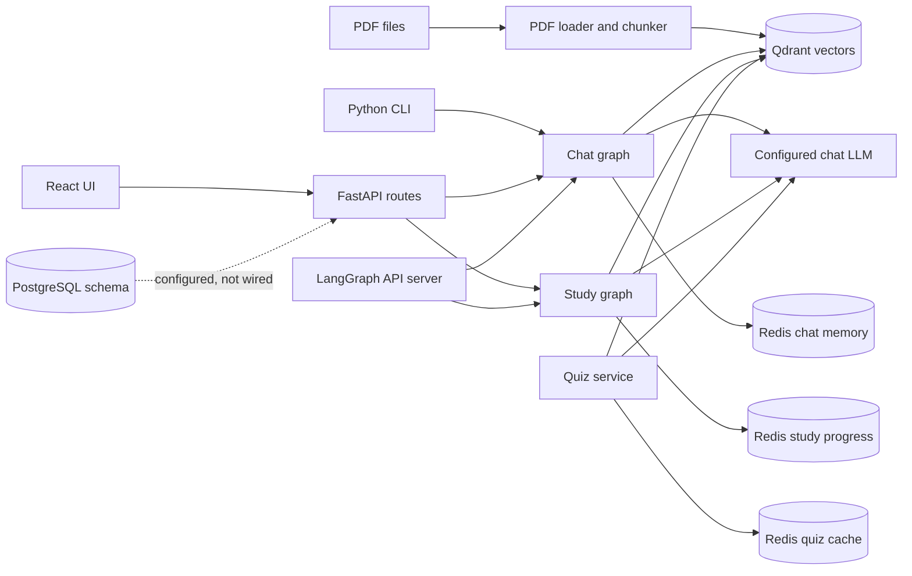

# Architecture

## 1. Overview

Financial Study ingests financial-education PDFs, stores searchable chunks in Qdrant, and provides chapter summaries, a chat interface over studied material, and generated quizzes. Users reach the system through a FastAPI web API and React UI, command-line entry points, or the LangGraph API server configured for the two compiled workflows. Chat and study workflows currently share a global Redis progress/memory store; PostgreSQL ownership models exist but are not wired into application execution.

## 2. High-Level Architecture



`frontend.server` serves the existing HTTP API and built static UI. LangGraph CLI serves the compiled graphs as an Agent Server; it does not expose the FastAPI routes. The PostgreSQL models and migration are currently a separate persistence foundation.

## 3. Graph Design

Both compiled graphs use `StudyState`. The schema has no explicit reducers; LangGraph's default update behavior applies to every field.

### State Schema

| Field | Type | Reducer | Purpose |
|---|---|---|---|
| `current_module` | `int` | Default | Current study module |
| `current_chapter` | `int` | Default | Current study chapter |
| `chunks` | `list[Document]` | Default | Chapter documents loaded from Qdrant |
| `point_ids` | `list[Any]` | Default | Qdrant IDs corresponding to loaded chunks |
| `total_chars` | `int` | Default | Character count of chapter chunks |
| `summary` | `str` | Default | Generated chapter summary |
| `messages` | `list[AnyMessage]` | Default | Messages returned by the RAG node |
| `user_input` | `str` | Default | User's chat question |
| `guardrail_flagged` | `bool` | Default | Whether input was flagged |
| `chatbot_response` | `str` | Default | Chat graph response |
| `validation_passed` | `bool` | Default | Chat answer validation result |
| `rag_retry_count` | `int` | Default | Chat retrieval/validation retry count |
| `rag_search_query` | `str` | Default | Query used for the next RAG search |
| `evidence_found` | `bool` | Default | Whether retrieval passed the evidence gate |
| `memory_context` | `str` | Default | Redis conversation context supplied by callers |
| `llm_session_id` | Optional `str` | Default | Opaque browser selection reference; never a credential |
| `summary_retry_count` | `int` | Default | Summary validation retry count |
| `summary_validation_passed` | `bool` | Default | Summary validation result |

### Node Catalog

| Node | Responsibility | Reads | Writes | External calls |
|---|---|---|---|---|
| `filter_by_memory` | Load current progress and chapter chunks | Existing Redis progress; no required graph input | Position, chunks, IDs, character count, summary retry initialization | Redis, Qdrant |
| `summarise_chunks` | Generate a detailed chapter summary | Chunks, position, character count | `summary` | Configured study LLM |
| `validate_summary` | Check quality with an LLM and enforce a length range | Summary, character count, retry count | Validation flag and retry count | Configured study LLM |
| `update_progress` | Mark chunks as seen and advance position | Position, chunks, point IDs | Updated module/chapter when chunks exist | Qdrant, Redis |
| `guardrail_node` | Flag abusive/sexual words and prompt-injection patterns | `user_input` | `guardrail_flagged`; warning response when flagged | None |
| `rag_lookup_node` | Classify topic, retrieve evidence, answer, cite chapters | Input, search query, memory context, messages | Response, evidence flag, messages, cleared search query after answer | Chat LLM, Qdrant |
| `validate_response_node` | Validate answer; retry with a rewritten search query | Response, user input, retry count | Validation flag, retry count, search query, or final note | Chat LLM |

### Edges and Routing

| From | To | Condition |
|---|---|---|
| `__start__` | `filter_by_memory` | Study graph entry |
| `filter_by_memory` | `summarise_chunks` | Always |
| `summarise_chunks` | `validate_summary` | Always |
| `validate_summary` | `update_progress` | `valid` or `max_retries` |
| `validate_summary` | `summarise_chunks` | `retry` |
| `update_progress` | `__end__` | Always |
| `__start__` | `guardrail_node` | Chat graph entry |
| `guardrail_node` | `__end__` | `flagged` |
| `guardrail_node` | `rag_lookup_node` | `clean` |
| `rag_lookup_node` | `__end__` | `evidence_missing` |
| `rag_lookup_node` | `validate_response_node` | `has_evidence` |
| `validate_response_node` | `__end__` | `valid` or `max_retries` |
| `validate_response_node` | `rag_lookup_node` | `retry` |

The dashed arrows are conditional edges; their labels are the routing outcomes.

```mermaid
%% Dashed arrows are conditional routes; labels are routing outcomes.
flowchart TD
  subgraph study["Study graph"]
    study_start([<p>__start__</p>]):::first
    filter_by_memory(filter_by_memory)
    summarise_chunks(summarise_chunks)
    validate_summary(validate_summary)
    update_progress(update_progress)
    study_end([<p>__end__</p>]):::last
    study_start --> filter_by_memory;
    filter_by_memory --> summarise_chunks;
    summarise_chunks --> validate_summary;
    validate_summary -. &nbsp;retry&nbsp; .-> summarise_chunks;
    validate_summary -. &nbsp;max_retries&nbsp; .-> update_progress;
    update_progress --> study_end;
  end
  subgraph chat["Chat graph"]
    chat_start([<p>__start__</p>]):::first
    guardrail_node(guardrail_node)
    rag_lookup_node(rag_lookup_node)
    validate_response_node(validate_response_node)
    chat_end([<p>__end__</p>]):::last
    chat_start --> guardrail_node;
    guardrail_node -. &nbsp;flagged&nbsp; .-> chat_end;
    guardrail_node -. &nbsp;clean&nbsp; .-> rag_lookup_node;
    rag_lookup_node -. &nbsp;evidence_missing&nbsp; .-> chat_end;
    rag_lookup_node -. &nbsp;has_evidence&nbsp; .-> validate_response_node;
    validate_response_node -. &nbsp;max_retries&nbsp; .-> chat_end;
    validate_response_node -. &nbsp;retry&nbsp; .-> rag_lookup_node;
  end
classDef default fill:#f2f0ff,line-height:1.2
classDef first fill-opacity:0
classDef last fill:#bfb6fc
```



## 4. Execution Flow

For `POST /api/chat`, FastAPI validates `ChatRequest`, formats recent Redis memory, builds the chat graph, and invokes it with `user_input` and `memory_context`. The guardrail either ends the graph or routes to RAG. RAG classifies the topic, searches seen Qdrant chunks, checks evidence, and generates a response. The answer validator ends or retries retrieval. FastAPI stores the question and response in Redis and returns `ChatResponse`.

```mermaid
sequenceDiagram
    actor User
    participant API as FastAPI
    participant Redis
    participant Graph as Chat graph
    participant LLM
    participant Qdrant
    User->>API: POST /api/chat {query}
    API->>Redis: format recent memory
    API->>Graph: invoke user_input, memory_context
    Graph->>Graph: guardrail_node
    alt input flagged
        Graph-->>API: warning in chatbot_response
    else input clean
        Graph->>LLM: classify financial topic
        Graph->>Qdrant: search seen chunks
        Graph->>LLM: check evidence and generate answer
        Graph->>LLM: validate answer; rewrite query on retry
        Graph-->>API: final graph state
    end
    API->>Redis: store question and response
    API-->>User: ChatResponse
```

The graph uses `invoke`, not streaming. Chat and teach handlers run synchronously
in FastAPI's threadpool; quiz generation offloads its synchronous work explicitly.
Browser callers supply an opaque `llm_session_id`, which nodes resolve through
the encrypted credential store. Calls without a reference use environment defaults.

## 5. Persistence and Memory

| Mechanism | Current use |
|---|---|
| LangGraph checkpointer | None configured in either graph builder |
| LangGraph store | None configured |
| Threads/resume | No thread ID or graph resume flow is provided by application code |
| Qdrant | PDF chunks, embeddings, `seen` metadata, and similarity search |
| Redis chat memory | Global `chat:memory` list; 30-day TTL; older entries summarized |
| Redis study progress | Global module/chapter keys; no TTL |
| Redis quiz cache | Full quiz with answers, keyed by quiz ID; quiz service uses a one-hour TTL constant |
| Redis LLM settings | Fernet-encrypted provider selection and credential at `llm:sess:<UUID>`; 12-hour TTL by default |
| PostgreSQL | `users`, `user_sessions`, and `study_progresses` schema/migration exists; application routes and graphs do not yet use it |

Graph state is not resumed from a LangGraph checkpoint. Study state is read and written explicitly through Redis and Qdrant. Chat context is loaded from Redis by API/CLI callers and supplied as an input field.

## 6. Human-in-the-Loop and Error Handling

There are no interrupts or human approval steps. Summary and chat validation use conditional retry loops; both route after a retry count reaches three. A missing study chapter skips LLM work and leaves progress unchanged. Missing RAG evidence ends with a fallback response. Quiz routes catch broad exceptions and map them to HTTP responses; Redis memory degrades with logging when unavailable. Other LLM/Qdrant failures have no graph-level recovery edge.

## 7. Tools and Integrations

No LangGraph tools are registered or bound to an LLM.

| Integration | Purpose | Inputs and outputs |
|---|---|---|
| Chat LLM via `llm.factory.get_chat_model` | Topic classification, evidence check, chat answer, answer validation/query rewrite, quiz generation | LangChain messages in; provider response content out |
| Study LLM via `llm.factory.get_chat_model` | Chapter summary and summary quality check | LangChain messages in; response content out |
| HuggingFace embeddings | Embed chunks for Qdrant similarity search | Chunk text in; 384-dimensional normalized vectors by default |
| Qdrant | Upsert, scroll, seen-state updates, and similarity search | Documents/metadata and search query in; documents and point IDs out |
| Redis | Conversation memory, global study progress, and quiz cache | Redis keys/lists/values; service-specific strings and JSON |
| LangSmith | Optional environment-only tracing; browser-session workflows and connection tests disable it, including quiz worker invocations | No browser credentials in traces or graph state |
| PostgreSQL/SQLAlchemy | Initial user/session/progress persistence schema only | Async SQLAlchemy session factory and Alembic migration; not wired to graph/API |

## 8. Configuration

Settings are loaded from `.env` by Pydantic Settings. Names below are environment names corresponding to declared settings or the selected Google provider integration. No value in this table is a credential.

| Name | Required | Purpose | Example placeholder |
|---|---|---|---|
| `LLM_CHAT_MODEL_NAME` | No | Chat and quiz model | `ollama:<model>` |
| `LLM_STUDY_MODEL_NAME` | No | Study summary model | `google_genai:<model>` |
| `LLM_TEMPERATURE` | No | Study generation temperature | `<float>` |
| `LLM_KEY_ENCRYPTION_KEY` | For browser selections | Fernet encryption key, consistent across workers | `<Fernet key>` |
| `LLM_SESSION_TTL_SECONDS` | No | Selection/cookie TTL, default 43200 seconds | `<seconds>` |
| `GOOGLE_API_KEY` | When using Google Gemini | Google provider credential | `<Google API key>` |
| `OLLAMA_BASE_URL` | No | Base URL default for a browser Ollama selection | `<Ollama URL>` |
| `OLLAMA_MODEL` | No | Declared Ollama setting; model selection uses `LLM_*_MODEL_NAME` | `<model>` |
| `EMBEDDING_MODEL_NAME` | No | HuggingFace embedding model | `<model name>` |
| `EMBEDDING_NORMALIZE` | No | Normalize embedding vectors | `<true or false>` |
| `QDRANT_URL` | No | Qdrant endpoint | `<Qdrant URL>` |
| `QDRANT_COLLECTION` | No | Vector collection | `<collection name>` |
| `RAG_TOP_K` | No | Number of chunks used in chat retrieval | `<integer>` |
| `CHUNK_SIZE` | No | Ingestion chunk size | `<integer>` |
| `CHUNK_OVERLAP` | No | Ingestion chunk overlap | `<integer>` |
| `LANGSMITH_TRACING` | No | LangSmith tracing toggle | `<true or false>` |
| `LANGSMITH_API_KEY` | When enabling LangSmith | LangSmith credential | `<LangSmith API key>` |
| `LANGSMITH_PROJECT` | No | LangSmith project name | `<project name>` |
| `DATABASE_URL` | Only for Alembic/PostgreSQL | PostgreSQL connection string | `postgresql+asyncpg://<user>:<password>@<host>:5432/<database>` |
| `REDIS_URL` | For Redis-backed features | Redis connection string | `redis://<host>:6379` |
| `QUIZ_DEFAULT_COUNT` | No | Declared setting; quiz code currently defaults count independently | `<integer>` |
| `QUIZ_CACHE_TTL` | No | Declared setting; quiz code currently uses a module constant | `<seconds>` |

`GOOGLE_API_KEY` is read by the Google LangChain provider, not by the `Settings`
model. `OLLAMA_MODEL`, `QUIZ_DEFAULT_COUNT`, and `QUIZ_CACHE_TTL` remain legacy
settings not consumed directly by graph/quiz execution.

The browser settings panel uses `GET /api/llm/providers`,
`GET/PUT/DELETE /api/llm/config` and `POST /api/llm/test`. The provider registry
describes editable examples and required fields. The factory uses
`AzureChatOpenAI` directly for Azure and `init_chat_model` for the other installed
integrations. Quiz no longer caches one global model: the selection is resolved
once per generation and passed explicitly to chapter workers.

Selections apply to all three workflows. Only a random UUID reference is passed
through graph state. SecretStr masks accidental representations, Fernet protects
the whole Redis value, and the HttpOnly SameSite=Lax cookie is Secure on HTTPS.
API responses expose only `has_key` and a masked suffix; validation responses and
provider-failure responses do not echo submitted credentials. Settings mutations
reject cross-origin browser requests. Selection expiry or deletion restores the
environment defaults; Redis failures and undecryptable values are explicit 503s,
not silent fallback. Changing the encryption key requires clearing/re-entering
existing selections.

These are anonymous credential sessions, not authenticated user sessions. Global
memory, study progress, quiz ownership and Qdrant seen flags are unchanged.
User-selected custom/Ollama endpoints require a trusted local deployment or
external authorization and network egress controls; no endpoint allowlist is
implemented. Test connection sends a short prompt and does not persist the form.

The graph manifest uses `dependencies`, `graphs`, `env`, and `python_version`. The current graphs define no `auth`, `store`, or `checkpointer` manifest configuration. The `langgraph.json` reference was checked against the LangGraph CLI documentation; the lockfile resolves LangGraph `1.2.2` and `langgraph-cli` `0.4.38`.

## 9. Deployment

`langgraph.json` points to the compiled graph exports in `graph/graph_builder.py`. Local development uses `uv run langgraph dev`; it does not require Docker. `uv run langgraph build -t financial-study:latest` builds the LangGraph API server Docker image and does require Docker. This image serves the graph API, not `frontend.server` or the existing FastAPI chat/quiz/teach routes.

The repository's [Compose stack](../compose.yaml) runs the FastAPI/UI app,
Redis and Qdrant together; it does not start Ollama, PostgreSQL, or the separate
LangGraph server. The [Dockerfile](../Dockerfile) builds the UI with Node and
installs locked Python dependencies into a Python 3.12 runtime running as a
non-root user. Compose binds the web port to loopback, keeps datastore ports
internal, persists datastore/model caches in named volumes, and mounts `data`
for explicit ingestion. The app health check includes Redis and Qdrant readiness
without calling a model. Internet-provider defaults and the Fernet key are
configured through `.env`; ingestion is a manual command to avoid duplicate
indexing on every startup. See the [deployment instructions](../README.md#deployment).

The LangGraph CLI documentation was checked for LangGraph `1.2.2` and CLI `0.4.38` on 2026-10-26. See [configuration reference](https://docs.langchain.com/langsmith/cli#configuration-file), [CLI reference](https://docs.langchain.com/langsmith/cli), and [local development guide](https://docs.langchain.com/langsmith/local-dev-testing).

## 10. Design Decisions and Limitations

- Chat and study state share a TypedDict even though their fields are workflow-specific.
- Redis progress and memory are global; they are not scoped to the new SQLAlchemy session models.
- No checkpointing, thread resume, or human-in-the-loop flow is configured.
- The graph builders compile new instances when called; module-level exports are additionally provided for LangGraph CLI.
- The application has both FastAPI routes and LangGraph Agent Server exports; they are separate serving surfaces.
- The study prompt targets 50-80% of input length while validation accepts 50-75%.
- `langgraph.json` was validated by the installed CLI's documented schema/commands; a live Docker image build and live PostgreSQL migration require those services to be available.

## 11. Extension Guide

Add a graph node as a typed function in the relevant `graph/*_nodes.py`, register it with `StateGraph.add_node`, and add its normal or conditional edges in `graph/graph_builder.py`. Add state fields in `graph/state.py` and update this guide and the generated graph diagram. To add a tool, define and bind it explicitly in the LLM workflow; no LangGraph tool binding currently exists. To add a subgraph, compile it separately and register it as a node in the parent graph. Regenerate the diagram with `uv run python -m scripts.generate_graph`.